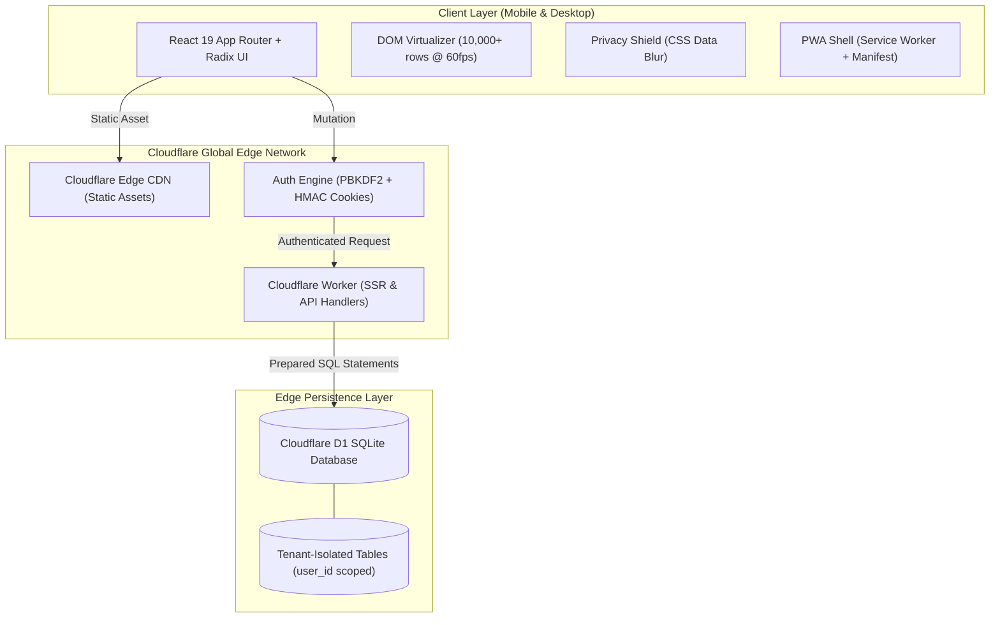

<div align="center">

# 🌿 Pocket

### Personal finance, net worth & expense intelligence engine running on Cloudflare Workers and D1 SQLite

[](https://github.com/akazad13/pocket/actions)
[](https://nextjs.org/)
[](https://react.dev/)
[](https://www.typescriptlang.org/)
[](https://workers.cloudflare.com/)
[](https://developers.cloudflare.com/d1/)
[](https://tailwindcss.com/)
[](LICENSE)

[Overview](#-overview) •
[Architecture](#-architecture) •
[Tech Stack](#-tech-stack) •
[Feature Highlights](#-feature-highlights) •
[Quick Start](#-quick-start) •
[Testing](#-testing) •
[Deployment](#-deployment) •
[Documentation](#-documentation)

</div>

---

## 📌 Overview

**Pocket** is a mobile-first, privacy-respecting financial operating system tailored for Bangladeshi Taka (`BDT`, `Asia/Dhaka`). Engineered for extreme edge performance with Next.js 16 App Router, React 19, and Cloudflare Workers, Pocket executes at zero cold-start latency with all data persisted in tenant-isolated Cloudflare D1 SQLite storage.

### Key Highlights
- ⚡ **Zero Cold-Start Edge Execution**: Runs serverless SSR and API routes globally across Cloudflare Workers with D1 edge SQLite.
- 🔒 **Cryptographic Sovereignty**: PBKDF2 SHA-256 password hashing (100,000 iterations), signed HMAC session cookies, and strict per-query multi-tenant data isolation (`WHERE user_id = ?`).
- 📊 **Financial Health Engine**: Dynamic balance math, 12-month net worth trend analysis, spending burn-rate velocity, and an automated 0-100 wellness index.
- 🇧🇩 **Localized Intelligence**: DSE equity portfolio tracking, monthly compounding DPS/FD estimators, remittance converter with official 2.5% Bangladesh government incentive, and gold/silver Zakat calculation.
- 🏎️ **DOM Virtualization**: Custom windowed virtualizer rendering 10,000+ transaction rows at 60fps with instant hashtag discovery.

---

## 🏛 Architecture



> [!NOTE]
> Pocket strictly uses manual entry integrity. It performs zero insecure third-party bank scraping and transmits no telemetry to external trackers.

---

## 🛠 Tech Stack

| Domain | Technologies |
| :--- | :--- |
| **Edge Runtime** | Cloudflare Workers, Wrangler CLI |
| **Framework & UI** | Next.js 16 (App Router), React 19, Radix UI, Tailwind CSS v4 |
| **Persistence** | Cloudflare D1 (Serverless Distributed SQLite), Drizzle ORM |
| **Security & Auth** | PBKDF2 SHA-256, HMAC-signed session cookies, strict tenant scoping |
| **Language & Tooling** | TypeScript 5.9 (Strict), Vitest, Node.js 22 |

---

## ✨ Feature Highlights

| Domain | Capabilities |
| :--- | :--- |
| **Ledger & Expenses** | Windowed virtualization, atomic split receipts, spending velocity indicators, multi-format JSON/CSV export. |
| **Net Worth & Portfolio** | Dynamic balance aggregation, 12-month asset trendline, DSE equity tracker (unrealized P&L). |
| **Specialized Tools** | DPS compounding estimator, Sanchayapatra maturity rules, Remittance FX (+2.5% incentive), Gold/Silver Zakat. |
| **Command Palette** | Global <kbd>Ctrl</kbd> + <kbd>K</kbd> palette for fast keyboard-driven expense entry and account navigation. |

---

## 🚀 Quick Start

### Prerequisites
- **Node.js**: `>=22.13.0`
- **Package Manager**: Built-in `npm`

### 1. Clone & Clean Install
```bash
git clone https://github.com/akazad13/pocket.git
cd pocket
npm run install:ci
```

### 2. Start Local Development
```bash
npm run dev
```
Open `http://127.0.0.1:5173`. Local state automatically persists inside `.wrangler/state`.

---

## ☁️ Deployment

Pocket deploys serverless to Cloudflare Workers and D1:

```bash
# 1. Provision D1 Database
npx wrangler d1 create pocket-db

# 2. Execute schema migration
npx wrangler d1 execute pocket-db --remote --file drizzle/schema.sql

# 3. Configure secrets
npx wrangler secret put POCKET_AUTH_SECRET
npx wrangler secret put POCKET_USERNAME
npx wrangler secret put POCKET_PASSWORD

# 4. Build and deploy
npm run build
npx wrangler deploy
```

---

## 🧪 Testing

| Test Tier | Scope | Command |
| :--- | :--- | :--- |
| **Static Verification** | Strict TypeScript check | `npm run typecheck` |
| **Unit Tests** | 137 unit tests for all financial math and models | `npm run test:unit` |
| **API Smoke Tests** | Live API assertion suite against dev server | `npm run smoke` |
| **Multi-Tenant Tests** | Tenant data isolation verification | `npm run smoke:multi-user` |

---

## 📚 Documentation

| Document | Focus |
| :--- | :--- |
| 🚀 [docs/DEPLOYMENT.md](docs/DEPLOYMENT.md) | Cloudflare Workers and D1 production deployment playbook |
| 🏛️ [docs/ARCHITECTURE.md](docs/ARCHITECTURE.md) | Edge lifecycle, module boundaries, and security model |
| 🗄️ [docs/DATA_MODEL.md](docs/DATA_MODEL.md) | 10-table SQLite schema and balance calculation logic |
| ✨ [docs/FEATURES.md](docs/FEATURES.md) | Detailed feature inventory and roadmap |
| 🧪 [docs/TESTING.md](docs/TESTING.md) | Test suite breakdown and quality gates |

---

## 👤 Author

**Md. Abul Kalam**
- GitHub: [@akazad13](https://github.com/akazad13)
- LinkedIn: [Md. Abul Kalam](https://linkedin.com/in/akazad13)

---

## 📄 License

This project is licensed under the [MIT License](LICENSE).
