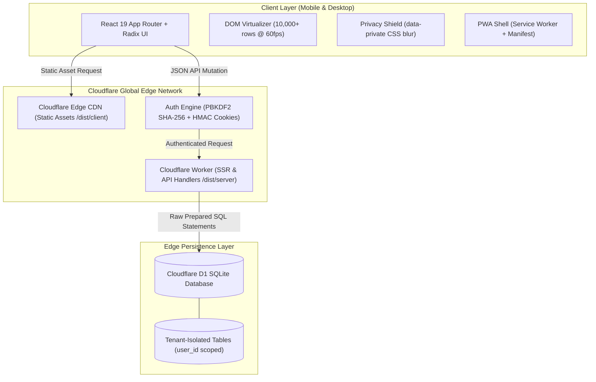
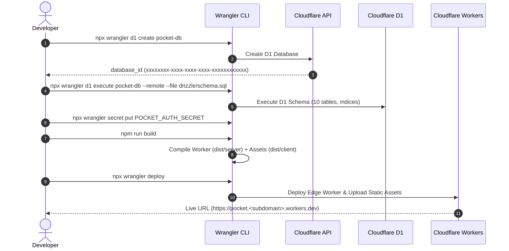

<div align="center">

# 🌿 Pocket

### Personal Finance, Net Worth & Expense Intelligence Engine

*A mobile-first, privacy-respecting financial operating system in Bangladeshi Taka (BDT, `Asia/Dhaka`).*  
*Engineered for extreme edge performance with Next.js 16 App Router, React 19, Cloudflare Workers, and D1 SQLite.*

---

[](https://github.com/akazad13/pocket)
[](https://nextjs.org/)
[](https://react.dev/)
[](https://workers.cloudflare.com/)
[](https://developers.cloudflare.com/d1/)
[](https://www.typescriptlang.org/)
[](https://tailwindcss.com/)
[](tests/unit/)

[Overview](#-system-architecture) •
[Features](#-feature-matrix) •
[Quick Start](#-quick-start-local-development) •
[Deployment Guide](#-production-deployment-cloudflare-workers--d1) •
[Documentation](#-documentation-suite)

</div>

---

## 🏛 System Architecture

Pocket runs entirely on the Cloudflare global network, combining serverless server-side rendering (SSR), high-speed static asset caching, and SQLite edge storage with zero cold-start overhead:



---

## ✨ Feature Matrix

Pocket provides a complete personal finance suite built around manual entry integrity (no vulnerable bank scraping):

### 🔐 Authentication & Multi-Tenancy
| Feature | Details | Status |
|---|---|:---:|
| **Cryptographic Auth** | PBKDF2 SHA-256 password hashing with 100,000 iterations and 128-bit unique salts. | `Production-Ready` |
| **Tamper-Proof Sessions** | Signed HMAC `pocket_session` cookies with automated 7-day expiration and rotation. | `Production-Ready` |
| **Tenant Data Isolation** | Every database query is strictly scoped by `WHERE user_id = ?`, with zero cross-tenant visibility. | `Production-Ready` |
| **User Profile Center** | Real-time display name modification, credential rotation, tenant metrics, and instant backups. | `Production-Ready` |

### ⚡ Transaction Intelligence & Ledger
| Feature | Details | Status |
|---|---|:---:|
| **Windowed Virtualization** | Custom DOM virtualization combined with CSS `content-visibility: auto` effortlessly renders 10,000+ entries at 60fps. | `Production-Ready` |
| **Atomic Split Expenses** | Split individual bills across multiple categories with live remainder tracking and one-click undo. | `Production-Ready` |
| **Spending Velocity** | Live daily burn rate calculation, projected month-end totals, and safe daily allowance indicators. | `Production-Ready` |
| **Hashtags & Notes** | Extract `#hashtags` automatically from notes (Bengali and English) with interactive tag filters and tag reports. | `Production-Ready` |
| **Multi-Format Export** | Full JSON database backups with schema validation, plus formula-safe CSV export for all transactions. | `Production-Ready` |

### 💰 Accounts, Net Worth & Investments
| Feature | Details | Status |
|---|---|:---:|
| **Dynamic Balance Computation** | Balances computed dynamically on-the-fly from opening balances, income, expenses, and transfers. | `Production-Ready` |
| **12-Month Net Worth Trend** | SVG line charts and tabular breakdowns reconstructing net worth progression across past months. | `Production-Ready` |
| **DSE Stock Portfolio** | Live equity holding manager with DSE blue-chip presets (GP, SQURPHARMA, BRACBANK), tracking unrealized P&L. | `Production-Ready` |
| **Term Accounts & DPS** | Compounding monthly DPS calculation, FD simple interest, and Sanchayapatra maturity estimators. | `Production-Ready` |
| **Remittance FX & Cash Incentive** | Foreign currency converter (USD, EUR, GBP, SAR, AED) with the official 2.5% Bangladesh Government incentive. | `Production-Ready` |
| **Zakat Calculator** | Nisab thresholds based on gold (7.5 vori) and silver (52.5 vori) with deductible short-term liabilities. | `Production-Ready` |

### 🩺 Financial Health Index (0–100)
A comprehensive wellness algorithm measuring resilience across four core pillars:
- 🛡️ **Emergency Runway** (Liquid assets vs. 3-month burn rate)
- 📈 **Net Savings Rate** (Monthly surplus percentage)
- 🎯 **Budget Adherence** (Category limit compliance streak)
- ⚖️ **Debt-to-Asset Ratio** (Total liabilities vs. total assets)

---

## ⌨️ Command Palette & Keyboard Shortcuts

Press <kbd>Ctrl</kbd> + <kbd>K</kbd> (or <kbd>Cmd</kbd> + <kbd>K</kbd> on macOS) anywhere in Pocket to open the command palette:

```
+-------------------------------------------------------------+
|  > Search transactions, open accounts, or run a tool...     |
+-------------------------------------------------------------+
|  QUICK ACTIONS                                              |
|  ➕ Add Expense            Add a new spending record        |
|  💵 Add Income             Record salary or dividend        |
|  🔁 Transfer Money         Move funds between accounts      |
|  ✂️ Split Expense          Split receipt across categories  |
|                                                             |
|  NAVIGATION & TOOLS                                         |
|  🩺 Financial Wellness     View 0-100 Health Score          |
|  📈 Stock Portfolio        Track DSE equity holdings        |
|  💱 Remittance Helper      Convert FX with 2.5% incentive   |
|  🌙 Toggle Dark Mode       Cycle Light / Dark / System      |
+-------------------------------------------------------------+
```

---

## 🚀 Quick Start (Local Development)

### 1. Prerequisites
- **Node.js**: `>=22.13.0` (Node `v22.13.1` or later recommended).
- **Package Manager**: Built-in `npm` (`npm run install:ci` executes deterministic clean install).

### 2. Setup & Execution
```bash
# Clone the repository
git clone https://github.com/akazad13/pocket.git
cd pocket

# Clean, deterministic dependency installation (Never run plain npm install)
npm run install:ci

# Start development server on http://127.0.0.1:5173
npm run dev
```

> [!NOTE]
> Local development automatically persists SQLite records inside `.wrangler/state`.

---

## ☁️ Production Deployment (Cloudflare Workers + D1)

Pocket is architected for zero-configuration deployment to Cloudflare:



### Deployment Steps Summary:

1. **Create Remote Database**:
   ```bash
   npx wrangler d1 create pocket-db
   ```
2. **Apply Consolidated Schema**:
   ```bash
   npx wrangler d1 execute pocket-db --remote --file drizzle/schema.sql
   ```
3. **Configure `wrangler.json`**:
   Insert the generated `database_id` into [wrangler.json](wrangler.json).
4. **Provision Encrypted Secrets**:
   ```bash
   npx wrangler secret put POCKET_AUTH_SECRET
   npx wrangler secret put POCKET_USERNAME
   npx wrangler secret put POCKET_PASSWORD
   ```
5. **Compile & Ship**:
   ```bash
   npm run build
   npx wrangler deploy
   ```

> [!TIP]
> Read the complete, comprehensive deployment guide in **[docs/DEPLOYMENT.md](docs/DEPLOYMENT.md)** for custom domain mapping, remote backups, and migration workflows.

---

## 🧪 Verification & Testing Pipeline

Pocket enforces a 4-tier verification gate to prevent regressions:

```
+-------------------------------------------------------------+
| Tier 1: Static Typecheck    | tsc --noEmit (code 0)         |
+-----------------------------+-------------------------------+
| Tier 2: Pure Unit Tests     | 137 tests passing (~1s)       |
+-----------------------------+-------------------------------+
| Tier 3: API Smoke Tests     | 164 assertions on dev server  |
+-----------------------------+-------------------------------+
| Tier 4: Multi-User Test     | Multi-tenant isolation checks |
+-------------------------------------------------------------+
```

```bash
# Run unit tests across all financial modules
npm run test:unit

# Run full API smoke test suite (requires dev server running)
npm run smoke

# Verify multi-user tenant isolation
npm run smoke:multi-user

# Static type verification
npm run typecheck
```

---

## 📚 Documentation Suite

| Document | Focus & Target Audience |
|---|---|
| **[docs/DEPLOYMENT.md](docs/DEPLOYMENT.md)** | Step-by-step production Cloudflare Workers + D1 deployment runbook. |
| **[docs/ARCHITECTURE.md](docs/ARCHITECTURE.md)** | Runtime architecture, edge lifecycle, module boundaries, and security model. |
| **[docs/DATA_MODEL.md](docs/DATA_MODEL.md)** | Complete 10-table SQLite schema, computed balance math, and migration runbook. |
| **[docs/AGENT_PLAYBOOK.md](docs/AGENT_PLAYBOOK.md)** | Autonomous AI agent standard operating procedures (SOPs) and top 10 pitfalls. |
| **[docs/FEATURES.md](docs/FEATURES.md)** | Exhaustive catalog of shipped capabilities and backlog roadmap. |
| **[docs/TESTING.md](docs/TESTING.md)** | Unit test inventory, assertion suites, and verification checklist. |
| **[AGENTS.md](AGENTS.md)** | Primary safety directives and prime rules for autonomous coding agents. |

---

## 🛡️ License & Data Privacy

Pocket is built as a single-owner / family private finance management system. It does not phone home, does not load third-party analytics trackers, and gives you 100% cryptographic sovereignty over your financial data.
