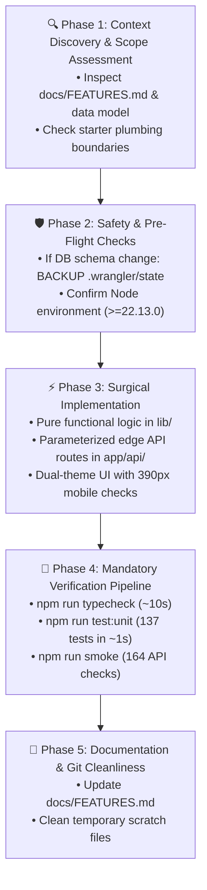

# 🤖 Pocket Autonomous Agent Playbook
### Standard Operating Procedures, Anti-Patterns & Verification Gates

> Architectural guidelines, execution SOPs, and error prevention protocols for autonomous AI agents (Antigravity, Gemini, Claude, Cursor) working on Pocket.

---

## 1. Guiding Philosophy for Autonomous Agents

1. **Protect Live Financial Records**: The local database at `.wrangler/state` contains the owner's real personal financial records. Any reset, destructive SQL, or file wiping is strictly prohibited.
2. **Preserve Codebase Density**: Application code in `app/` and `lib/` is written in a dense, compact style. Preserve local formatting and perform targeted search-and-replace rather than whole-file rewrites.
3. **Integer Currency Invariant**: All monetary values are integer cents in Bangladeshi Taka (BDT). Never compute or store floating-point currency.
4. **Dual Theme Synchronization**: Every single CSS rule introducing a background, text color, or border in `app/pocket.css` must have an identical dark mode override in `app/pocket-dark.css` under `html[data-theme=dark]`.
5. **Mandatory 4-Tier Verification**: No task is complete without passing the verification pipeline: TypeScript compile check, unit tests, and API smoke tests.

---

## 2. The 5-Phase Agent Execution Workflow



---

## 3. Surgical Implementation Recipes

### 3.1 Recipe: Adding Pure Business Logic (`lib/`)
1. Implement pure mathematical or parsing functions in `lib/<domain>.ts`.
2. Do not import `lib/database.ts` or `cloudflare:workers` in pure modules.
3. Add a comprehensive companion unit test in `tests/unit/<domain>.test.ts`.
4. Run `npm run test:unit` to verify in ~1s.

### 3.2 Recipe: Adding or Modifying Edge API Routes (`app/api/`)
1. Create or edit `app/api/<domain>/route.ts`.
2. Always enforce CSRF Origin validation for mutations:
   ```typescript
   const origin = request.headers.get("origin");
   if (origin && new URL(origin).origin !== new URL(request.url).origin) {
     return Response.json({ error: "Forbidden origin" }, { status: 403 });
   }
   ```
3. Use raw D1 prepared statements with bound parameters:
   ```typescript
   const db = database();
   const stmt = db.prepare('SELECT * FROM expenses WHERE user_id = ?').bind(userId);
   ```
4. Never destructure a variable named `{ method }` in route handlers (conflicts with HTTP verb parameter `method: 'POST'`). Alias it: `{ method: paidWith }`.
5. Add API test assertions to [tests/smoke.mjs](file:///d:/Projects/Github/akazad13/pocket/pocket/tests/smoke.mjs).

### 3.3 Recipe: Adding UI Components & Dialogs (`app/`)
1. Mount dialogs from [app/tracker.tsx](file:///d:/Projects/Github/akazad13/pocket/pocket/app/tracker.tsx) if globally triggered.
2. Key dialogs per opening (e.g. `<IncomeDialog key={openId ?? 'new'} ... />`) so internal state resets cleanly without synchronization `useEffect`s.
3. Write plain CSS classes in [app/pocket.css](file:///d:/Projects/Github/akazad13/pocket/pocket/app/pocket.css).
4. **Mirror all styles in dark mode** in [app/pocket-dark.css](file:///d:/Projects/Github/akazad13/pocket/pocket/app/pocket-dark.css) under `html[data-theme=dark]`.
5. Test responsive layout at 390px mobile viewport (bottom navigation bar + 160px container padding).
6. Support Privacy Mode:
   - Format all currency with `money()` from `lib/format.ts`.
   - Any raw unformatted numbers must be protected by an `html[data-private]` blur CSS rule.

### 3.4 Recipe: Modifying Database Schema
Follow the exact protocol in [docs/DATA_MODEL.md](file:///d:/Projects/Github/akazad13/pocket/pocket/docs/DATA_MODEL.md):
1. Copy `.wrangler/state` to `../pocket-db-backups/<timestamp>-<reason>/`.
2. Edit [db/schema.ts](file:///d:/Projects/Github/akazad13/pocket/pocket/db/schema.ts).
3. Run `npm run db:generate`.
4. Apply locally with Wrangler:
   ```powershell
   npx wrangler d1 execute DB --local --persist-to .wrangler/state --file drizzle/000N_name.sql --config .sites-runtime/local.json
   ```
5. Update SQL statements in `app/api/` and TypeScript types.
6. Run `npm run typecheck` and `npm run smoke`.

### 3.5 Recipe: Deploying to Cloudflare Workers & D1
Follow the comprehensive protocol in [docs/DEPLOYMENT.md](file:///d:/Projects/Github/akazad13/pocket/pocket/docs/DEPLOYMENT.md):
1. Provision remote D1 database: `npx wrangler d1 create pocket-db`.
2. Initialize schema: `npx wrangler d1 execute pocket-db --remote --file drizzle/schema.sql`.
3. Configure `wrangler.json` with the generated `database_id`.
4. Set production secrets:
   ```bash
   npx wrangler secret put POCKET_AUTH_SECRET
   npx wrangler secret put POCKET_USERNAME
   npx wrangler secret put POCKET_PASSWORD
   ```
5. Compile bundle and deploy:
   ```bash
   npm run build
   npx wrangler deploy
   ```

---

## 4. Top 10 Agent Traps & Anti-Patterns

| # | Severity | Trap / Anti-Pattern | Fatal Consequence | Correct Procedure |
|:---:|:---:|---|---|---|
| **1** | `🚨 CRITICAL` | Running `npm install` | Overwrites `package-lock.json` and alters starter dependencies | Always use `npm run install:ci` |
| **2** | `🚨 CRITICAL` | Deleting `.wrangler/state` | Permanently destroys the user's real financial records | Never touch without backing up to `../pocket-db-backups/` |
| **3** | `🚨 CRITICAL` | Storing float currency | Floating-point rounding errors in balances | Store integer cents only; calculate with integer cents |
| **4** | `⚠️ HIGH` | Destructuring `{ method }` in route handler | Shadowing of route parameter `method` leads to subtle runtime bugs | Alias parameter: `{ method: paidWith }` |
| **5** | `⚠️ HIGH` | Adding CSS without dark-mode override | Visual glitch and unreadable text in dark theme | Mirror every new background/color/border in `app/pocket-dark.css` |
| **6** | `⚠️ HIGH` | Editing starter plumbing | Breaks the Vinext / Worker hosting runtime | Never touch `build/`, `scripts/`, `vendor/`, `vite.config.ts` |
| **7** | `⚠️ HIGH` | Full file rewrites of `tracker.tsx` | Blows context and risks losing hundreds of minified handlers | Use targeted search-and-replace for specific sub-components |
| **8** | `⚡ MEDIUM` | Writing Python scripts with unescaped regex | Writes literal NUL (`\x00`) bytes into source files | Use raw strings (`r'...'`) in Python scripts |
| **9** | `⚡ MEDIUM` | Stale Vite dev cache error | `module does not provide export named X` error | Restart `npm run dev` by terminating the Node process on port 5173 |
| **10** | `⚡ MEDIUM` | Using em-dashes (`—`) in copy | Violates project documentation policy | Use regular dashes, hyphens, or colons |

---

## 5. Verification Commands Quick Reference

| Action | Command | Expected Output | Benchmark Duration |
|---|---|---|:---:|
| **Typecheck** | `npm run typecheck` | Clean exit (code 0), no output | ~10s |
| **Unit tests** | `npm run test:unit` | 137 tests pass, 0 failures | ~1s |
| **Smoke tests** | `npm run smoke` | 164 assertions `ok`, 0 failures | ~5s |
| **Multi-User Smoke** | `npm run smoke:multi-user` | Tenant isolation verified | ~2s |
| **Lint** | `npm run lint` | Clean (0 errors) | ~60s |
| **Production Build** | `npm run build` | Compiles Worker + client to `dist/` | ~15s |
