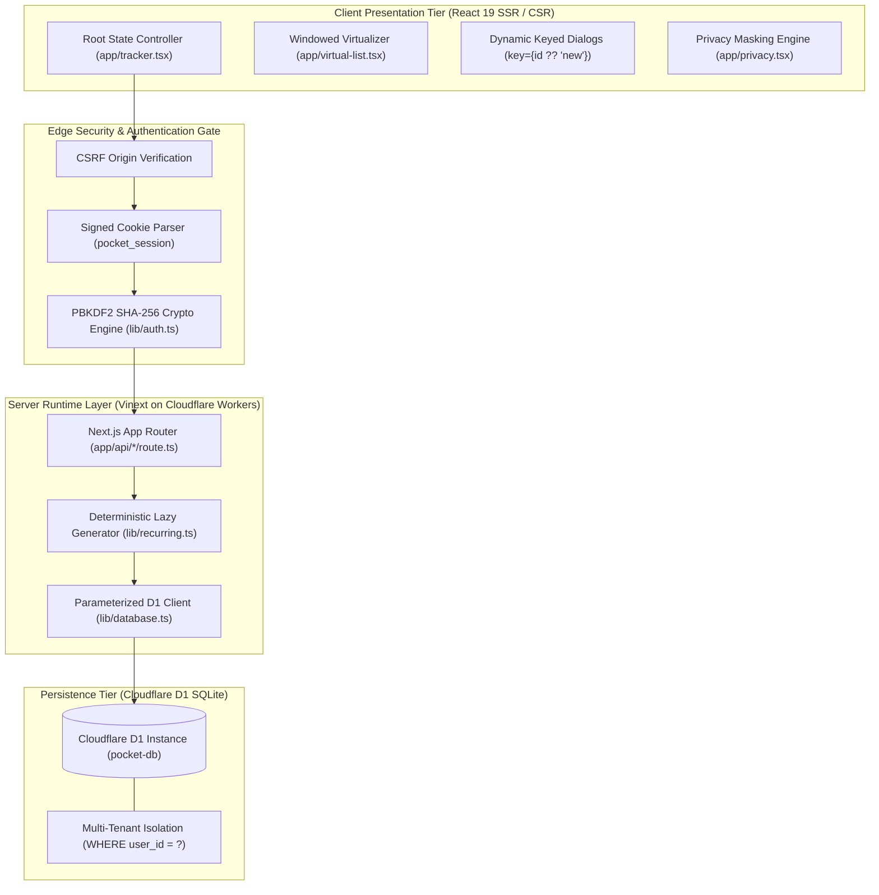
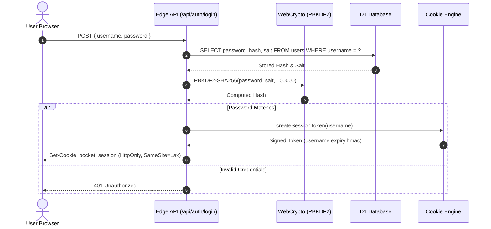

# 🏛️ Pocket System Architecture & Technical Specifications

> Deep-dive architectural specification for Pocket: edge runtime execution, component boundaries, multi-tenant authentication, and persistence models.

---

## 1. High-Level Architecture Topology

Pocket is compiled as an edge-native application running on **Cloudflare Workers** with **Cloudflare D1** SQLite. It does not rely on traditional Node.js persistent servers or third-party banking connectors; all state changes flow through authenticated edge route handlers.



---

## 2. Technology Stack & Edge Capabilities

| Architectural Layer | Technology | Version | Purpose & Invariants |
|---|---|---|---|
| **Runtime Environment** | Node.js / Cloudflare Workers | `>=22.13.0` | Native `--experimental-strip-types` and Cloudflare `nodejs_compat` runtime. |
| **Framework** | Next.js (App Router) | `16.3.4` | Server-Side Rendering (SSR) and Edge API route handlers. |
| **Compilation Engine** | Vinext + Vite | `1.0.0-beta.5` | Vite-based bundler producing standalone Cloudflare Worker bundles. |
| **Edge Hosting Target** | Cloudflare Workers | `2026-05-15` | Edge execution with global CDN asset delivery. |
| **Database** | Cloudflare D1 (SQLite) | Edge SQLite | Serverless relational database with bound queries (`env.DB`). |
| **Schema & Migrations** | Drizzle ORM / Drizzle Kit | `0.45.2` | Schema definitions (`db/schema.ts`) and SQL generation only. |
| **Component Primitives** | Radix UI + shadcn | React 19 | Accessible, headless UI primitives with custom plain CSS styling. |
| **Styling & Theme** | Tailwind CSS v4 + Custom Tokens | `4.2.1` | Dual-theme design tokens (`pocket.css`, `pocket-dark.css`). |
| **Unit Verification** | Node.js Test Runner | Native `node:test` | Ultra-fast unit testing (~1s for 137 assertions). |
| **API Smoke Tests** | Custom Fetch Test Suite | `tests/smoke.mjs` | 164 automated API integration checks against running server. |

---

## 3. Directory Structure & Module Boundaries

Pocket enforces strict architectural boundaries to separate client components, server route handlers, and shared business logic:

```
pocket/
├── app/                               # UI components & Edge API route handlers
│   ├── page.tsx                       # Root page (re-exports Tracker)
│   ├── layout.tsx                     # Global HTML layout, font preloads, theme scripts
│   ├── tracker.tsx                    # Central state manager, bottom nav, dialog coordinator
│   ├── accounts.tsx                   # Net worth calculation, accounts list, balance updates
│   ├── activity.tsx                   # Unified transaction ledger (expenses, income, transfers)
│   ├── virtual-list.tsx               # High-performance windowed DOM virtualization
│   ├── split-dialog.tsx               # Atomic receipt splitting dialog
│   ├── velocity.tsx                   # Spending pace & month-end forecast panel
│   ├── health-score.tsx               # Financial Wellness Index (0-100) panel & gauge
│   ├── portfolio.tsx                  # DSE stock portfolio tracker & equity valuation
│   ├── tags-report.tsx                # #hashtag aggregation and category distribution
│   ├── pocket.css                     # Primary styling, mobile breakpoints, light theme tokens
│   ├── pocket-dark.css                # Dark theme overrides (html[data-theme=dark])
│   └── api/                           # Edge route handlers (GET, POST, PUT, DELETE)
│       ├── auth/                      # Login, registration, profile, logout handlers
│       ├── expenses/                  # Expense CRUD & atomic split endpoints
│       ├── accounts/                  # Account operations, transfers, adjustments
│       ├── categories/                # Category management, styling, and atomic merge
│       ├── budgets/                   # Monthly category limits
│       └── backup/                    # JSON backup export and merge-only restore
├── lib/                               # Pure business logic and server utilities
│   ├── database.ts                    # 🔒 SERVER-ONLY: env.DB accessor and jsonChunks()
│   ├── account-db.ts                  # 🔒 SERVER-ONLY: Raw D1 queries for accounts
│   ├── recurring.ts                   # 🔒 SERVER-ONLY: Lazy recurring occurrence generator
│   ├── auth.ts                        # ⚡ PURE: PBKDF2 hashing, salts, HMAC session tokens
│   ├── format.ts                      # ⚡ PURE: BDT currency formatter (money()) & privacy mask
│   ├── velocity.ts                    # ⚡ PURE: Burn rate, leap-year days, projections
│   ├── wellness.ts                    # ⚡ PURE: Financial Health 0-100 scoring algorithm
│   ├── splits.ts                      # ⚡ PURE: Receipt splitting validators and allocations
│   ├── tags.ts                        # ⚡ PURE: Regex hashtag parser (Bengali & English)
│   ├── portfolio.ts                   # ⚡ PURE: Equity portfolio gains and allocation weights
│   └── terms.ts                       # ⚡ PURE: DPS compounding, FD simple interest, EMI splits
├── db/
│   └── schema.ts                      # Drizzle ORM schema (source of truth for migrations)
├── drizzle/                           # Versioned migrations (0000..0014) + consolidated schema.sql
├── tests/                             # Unit and integration test suites
│   ├── unit/*.test.ts                 # 137 unit tests for pure lib/ modules
│   ├── smoke.mjs                      # 164 API checks against dev server
│   └── multi-user-smoke.mjs           # Multi-tenant registration & isolation tests
└── wrangler.json                      # Cloudflare Workers & D1 deployment configuration
```

---

## 4. Key Architectural Patterns

### 4.1 Client-Safe vs. Server-Only Isolation
To maintain portability across the Cloudflare edge runtime and local Node.js test runners:
- **Server-Only Modules**: Modules importing `cloudflare:workers` (`lib/database.ts`, `lib/account-db.ts`, `lib/recurring.ts`) must never be imported into client components (`"use client"`).
- **Client-Safe Modules**: Helpers in `lib/*.ts` are purely functional and dependency-free. They are bundled safely into React client components and executed in `node:test`.
- **Type Isolation**: If a client component requires server types, use `import type { ... }` exclusively.

### 4.2 Raw Parameterized D1 Database Access
Pocket uses Drizzle strictly for schema generation. At runtime, performance and zero-cold-start execution are prioritized using **raw prepared statements**:

```typescript
// Example: Authenticated transaction read
const db = database();
const stmt = db.prepare(`
  SELECT id, category, cents, date, note, method, account
  FROM expenses
  WHERE user_id = ? AND date LIKE ?
  ORDER BY date DESC
`).bind(userId, `${month}-%`);

const { results } = await stmt.all<ExpenseRow>();
```

> [!IMPORTANT]
> **Parameter Binding Limit**: Cloudflare D1 enforces a limit of 100 bound parameters per query. Bulk inserts (such as JSON restore) use `json_each(?)` with 500KB chunking implemented in `lib/database.ts`.

---

## 5. Security & Multi-Tenant Authentication Architecture



### Authentication Invariants:
1. **Password Security**: Passwords are never stored in plaintext. They are salted with 128-bit random salts and hashed using PBKDF2 SHA-256 with 100,000 iterations.
2. **Session Cookies**: The `pocket_session` cookie contains a payload of `${username}.${expiresAt}` signed with an HMAC derived from `POCKET_AUTH_SECRET`.
3. **Tenant Scoping**: All queries across `expenses`, `income`, `accounts`, `budgets`, `bills`, and `recurring` require an authenticated `user_id`. Non-admin custom category keys and budgets are namespaced (`${userId}:${categoryName}`) to prevent primary key collision.
4. **CSRF Protection**: All mutation endpoints (`POST`, `PUT`, `DELETE`) inspect the `Origin` header. Mismatches are rejected with HTTP 403 Forbidden.
