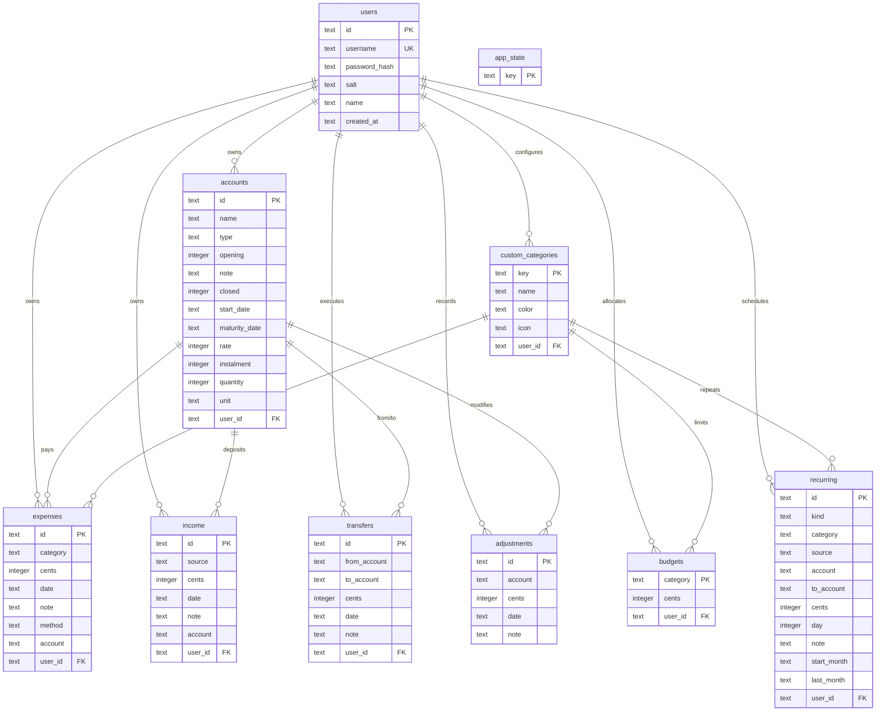
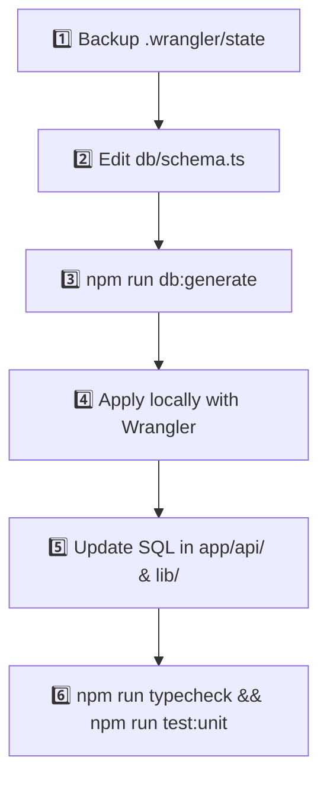

# 🗄️ Pocket Data Model & Persistence Architecture
### D1 SQLite Schema, Relational Model, Invariants & Migrations

> Complete reference manual for Pocket's 10-table relational schema, dynamic balance math, multi-tenant isolation, and safe migration SOP.

---

## 1. Storage Topology & Invariants

Pocket uses **Cloudflare D1** (serverless SQLite at the edge) in production and the Cloudflare Wrangler emulator (`.wrangler/state`) during local development.

- **Primary Schema Definition**: [db/schema.ts](file:///d:/Projects/Github/akazad13/pocket/pocket/db/schema.ts) (Drizzle ORM syntax used for migration generation).
- **Consolidated Production Initializer**: [drizzle/schema.sql](file:///d:/Projects/Github/akazad13/pocket/pocket/drizzle/schema.sql) (One-command setup for remote D1).
- **Runtime Execution**: Raw prepared statements via `database()` in [lib/database.ts](file:///d:/Projects/Github/akazad13/pocket/pocket/lib/database.ts).
- **Versioned Migrations**: [drizzle/](file:///d:/Projects/Github/akazad13/pocket/pocket/drizzle/) containing migration scripts `0000_*.sql` through `0014_dear_zemo.sql`.

---

## 2. Entity-Relationship (ER) Diagram



---

## 3. Relational Table Specifications

### 3.1 Authentication & Tenant Management

#### `users`
Stores user authentication credentials, individual cryptographic salts, and profile metadata.
```sql
CREATE TABLE users (
  id TEXT PRIMARY KEY,                 -- Unique user ID (UUID)
  username TEXT NOT NULL,              -- Case-insensitive unique username
  password_hash TEXT NOT NULL,         -- PBKDF2 SHA-256 derived hex string (100k iterations)
  salt TEXT NOT NULL,                  -- 128-bit random hex salt
  name TEXT NOT NULL DEFAULT '',       -- Display name (e.g. 'Abul Kalam')
  created_at TEXT NOT NULL             -- ISO timestamp
);
CREATE UNIQUE INDEX users_username_unique ON users (username);
```

---

### 3.2 Core Transactions & Spending

#### `expenses`
Stores individual expense records.
```sql
CREATE TABLE expenses (
  id TEXT PRIMARY KEY,                 -- Client UUID (^[a-zA-Z0-9-]{1,64}$)
  category TEXT NOT NULL,              -- Category display name
  cents INTEGER NOT NULL,              -- Amount in integer cents (BDT)
  date TEXT NOT NULL,                  -- Calendar date 'YYYY-MM-DD'
  note TEXT NOT NULL DEFAULT '',       -- Optional note (max 200 chars)
  method TEXT NOT NULL DEFAULT '',     -- Payment method ('Cash', 'bKash', 'Card', etc.)
  account TEXT NOT NULL DEFAULT '',    -- Linked account ID ('' = unlinked)
  user_id TEXT NOT NULL DEFAULT 'admin'-- Tenant owner ID
);
```

#### `income`
Stores income and money inflows independently of expense categories.
```sql
CREATE TABLE income (
  id TEXT PRIMARY KEY,                 -- Client UUID
  source TEXT NOT NULL,                -- Income source ('Salary', 'Dividend', etc.)
  cents INTEGER NOT NULL,              -- Amount in integer cents (> 0)
  date TEXT NOT NULL,                  -- Calendar date 'YYYY-MM-DD'
  note TEXT NOT NULL DEFAULT '',       -- Optional memo
  account TEXT NOT NULL DEFAULT '',    -- Destination account ID ('' = unlinked)
  user_id TEXT NOT NULL DEFAULT 'admin'-- Tenant owner ID
);
```

---

### 3.3 Accounts, Balances & Transfers

#### `accounts`
Stores financial instruments, liquid accounts, debt facilities, and physical assets.
```sql
CREATE TABLE accounts (
  id TEXT PRIMARY KEY,                 -- Account UUID
  name TEXT NOT NULL,                  -- Account display name
  type TEXT NOT NULL,                  -- Account type identifier (see list below)
  opening INTEGER NOT NULL DEFAULT 0,  -- Opening balance in cents
  note TEXT NOT NULL DEFAULT '',       -- Account description
  closed INTEGER NOT NULL DEFAULT 0,   -- 1 = closed (hidden from pickers), 0 = active
  start_date TEXT NOT NULL DEFAULT '', -- Opening date 'YYYY-MM-DD'
  maturity_date TEXT NOT NULL DEFAULT '',-- Maturity date 'YYYY-MM-DD'
  rate INTEGER NOT NULL DEFAULT 0,     -- Interest rate in basis points (e.g. 850 = 8.50%)
  instalment INTEGER NOT NULL DEFAULT 0,-- Monthly payment in cents
  quantity INTEGER NOT NULL DEFAULT 0, -- Asset quantity in thousandths (1500 = 1.500)
  unit TEXT NOT NULL DEFAULT '',       -- Unit ('vori', 'gram', 'katha', 'decimal', 'shares')
  user_id TEXT NOT NULL DEFAULT 'admin'-- Tenant owner ID
);
```

*Supported `type` values:*
- **Liquid Assets**: `cash`, `bank`, `wallet`
- **Fixed Term & Savings**: `dps`, `fd`, `sanchayapatra`
- **Equities & Investments**: `shares`, `mutual_fund`
- **Tangible Assets**: `gold`, `property`
- **Lending**: `loan_given`
- **Debts / Liabilities**: `loan_taken`, `credit_card`
- **Other**: `other`

#### `transfers`
Represents movement of funds between two accounts without altering net worth.
```sql
CREATE TABLE transfers (
  id TEXT PRIMARY KEY,                 -- Transfer UUID
  from_account TEXT NOT NULL,          -- Source account ID
  to_account TEXT NOT NULL,            -- Destination account ID
  cents INTEGER NOT NULL,              -- Amount in integer cents (> 0)
  date TEXT NOT NULL,                  -- Date 'YYYY-MM-DD'
  note TEXT NOT NULL DEFAULT '',       -- Optional transfer note
  user_id TEXT NOT NULL DEFAULT 'admin'-- Tenant owner ID
);
```

#### `adjustments`
Signed balance updates for interest earned, service fees, or asset market value changes.
```sql
CREATE TABLE adjustments (
  id TEXT PRIMARY KEY,                 -- Adjustment UUID
  account TEXT NOT NULL,               -- Target account ID
  cents INTEGER NOT NULL,              -- Signed value difference (positive or negative)
  date TEXT NOT NULL,                  -- Date 'YYYY-MM-DD'
  note TEXT NOT NULL DEFAULT ''        -- Reason / memo
);
```

---

### 3.4 Budgets, Categories & Recurring Rules

#### `custom_categories`
Stores custom user categories with visual swatches and icons.
```sql
CREATE TABLE custom_categories (
  key TEXT PRIMARY KEY,                -- Lowercase unique key: lower(name)
  name TEXT NOT NULL,                  -- Category display name (1-50 chars)
  color TEXT NOT NULL DEFAULT '',      -- Hex swatch code from PALETTE
  icon TEXT NOT NULL DEFAULT '',       -- Lucide icon name from ICONS
  user_id TEXT NOT NULL DEFAULT 'admin'-- Tenant owner ID
);
```

#### `budgets`
Category spending caps per month.
```sql
CREATE TABLE budgets (
  category TEXT PRIMARY KEY,           -- Category display name (or tenant-prefixed key)
  cents INTEGER NOT NULL,              -- Monthly budget limit in integer cents
  user_id TEXT NOT NULL DEFAULT 'admin'-- Tenant owner ID
);
```

#### `recurring`
Scheduled generation rules for monthly expenses, income, and transfers.
```sql
CREATE TABLE recurring (
  id TEXT PRIMARY KEY,                 -- Rule UUID
  kind TEXT NOT NULL,                  -- 'expense' | 'income' | 'transfer'
  category TEXT NOT NULL DEFAULT '',   -- Category for expense rules
  source TEXT NOT NULL DEFAULT '',     -- Source for income rules
  account TEXT NOT NULL DEFAULT '',    -- Source account
  to_account TEXT NOT NULL DEFAULT '', -- Destination account for transfers
  cents INTEGER NOT NULL,              -- Amount in integer cents (> 0)
  day INTEGER NOT NULL,                -- Execution day of month (1-31)
  note TEXT NOT NULL DEFAULT '',       -- Memo
  start_month TEXT NOT NULL,           -- First month 'YYYY-MM'
  last_month TEXT,                     -- Latest executed month 'YYYY-MM'
  user_id TEXT NOT NULL DEFAULT 'admin'-- Tenant owner ID
);
```

#### `app_state`
Flag table for one-time initialization triggers.
```sql
CREATE TABLE app_state (
  key TEXT PRIMARY KEY                 -- e.g. 'categories_initialized'
);
```

---

## 4. Financial Calculations & Business Invariants

### 4.1 Integer Cents (Never Floating Point)
All monetary values are strictly represented as **integer cents**:
- User input (e.g. `"150.50"`) is validated via regex `^\d{1,9}(\.\d{1,2})?$` and converted: `Math.round(amount * 100)`.
- UI formatting uses `money(cents)` via `Intl.NumberFormat('en-BD', { style: 'currency', currency: 'BDT' })`.
- Floating point calculations are prohibited in storage and business logic to prevent rounding drift.

### 4.2 Dynamic Balance Computation
Account balances are **computed on the fly**, never stored as static balance columns:

$$\text{Balance} = \pm \text{opening} + \text{income} - \text{expenses} + \text{transfers}_{\text{in}} - \text{transfers}_{\text{out}} + \text{adjustments}$$

$$\text{Net Worth} = \sum \text{Asset Balances} - \sum \text{Liability Balances}$$

- **`values(accounts, income, expenses, transfers, adjustments)`**: Internal calculation for net worth. Debts (`loan_taken`, `credit_card`) are computed as negative numbers.
- **`shown(type, balance)`**: User-facing balance. Debts are inverted and displayed as a positive "Amount Owed".
- **Delete Protection**: Accounts with linked transactions cannot be deleted (returns HTTP 409 Conflict); they can only be closed (`closed = 1`).

---

## 5. Safe Schema Migration Playbook

> [!CAUTION]
> **DATABASE SAFETY GUARD**:
> `.wrangler/state` contains real personal financial data in local development. Never delete, wipe, or drop tables without an external backup.



### Migration Steps:

1. **Create External Backup**:
   ```powershell
   $timestamp = Get-Date -Format "yyyyMMdd-HHmmss"
   Copy-Item -Path ".wrangler\state" -Destination "..\pocket-db-backups\$timestamp-pre-migration" -Recurse
   ```
2. **Edit Schema**: Modify [db/schema.ts](file:///d:/Projects/Github/akazad13/pocket/pocket/db/schema.ts).
3. **Generate Migration**: Run `npm run db:generate` to produce `drizzle/000N_name.sql`.
4. **Apply Locally**:
   ```bash
   npx wrangler d1 execute DB --local --persist-to .wrangler/state --file drizzle/000N_name.sql --config .sites-runtime/local.json
   ```
5. **Update Route Queries & Types**: Keep TypeScript interfaces and raw SQL strings synchronized.
6. **Verify Clean Pipeline**: Ensure `npm run typecheck` and `npm run test:unit` pass cleanly.
