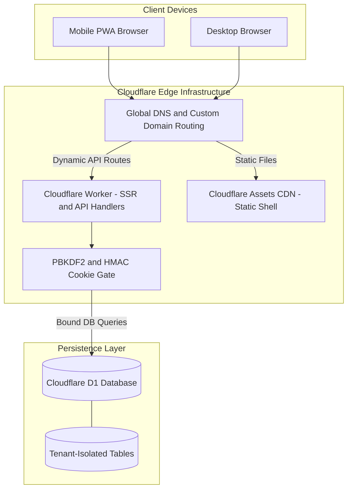
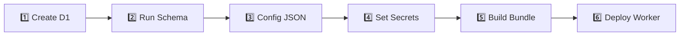
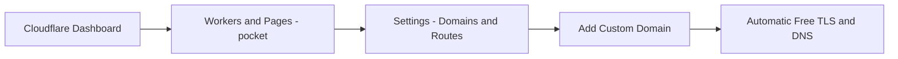

# 🚀 Pocket Production Deployment Guide
### Cloudflare Workers, Static Edge Assets & D1 Database

> Complete step-by-step production runbook to deploy Pocket on Cloudflare's serverless edge infrastructure.

---

## 🧭 Overview & Target Architecture

Pocket operates on Cloudflare's edge platform:
- **Compute**: Cloudflare Workers with `nodejs_compat` running Vinext (Vite + Next.js SSR).
- **Storage**: Cloudflare D1 (SQLite at the edge) bound as `DB`.
- **Assets**: Cloudflare Workers Assets serving the static client shell with global edge caching.
- **Authentication**: Multi-tenant PBKDF2 SHA-256 password hashing and HMAC-signed session cookies.



---

## 📋 Pre-Deployment Checklist

Before beginning, ensure you have completed the following:

- [ ] Installed **Node.js `>=22.13.0`** (`node -v` returns v22.13.1 or higher).
- [ ] Created a **Cloudflare Account** ([dash.cloudflare.com](https://dash.cloudflare.com/)).
- [ ] Installed the Wrangler CLI or prepared `npx wrangler`.
- [ ] Logged into Wrangler via CLI:
  ```bash
  npx wrangler login
  ```
- [ ] Backed up your local database if migrating existing records from `.wrangler/state`.

---

## 🛠️ Step-by-Step Deployment Runbook



### 1️⃣ Step 1: Provision the Cloudflare D1 Database

Run the Wrangler D1 provisioning command from the repository root:

```bash
npx wrangler d1 create pocket-db
```

Expected output:
```text
✅ Successfully created DB 'pocket-db'!

Add the following to your wrangler.json file:
{
  "d1_databases": [
    {
      "binding": "DB",
      "database_name": "pocket-db",
      "database_id": "xxxxxxxx-xxxx-xxxx-xxxx-xxxxxxxxxxxx"
    }
  ]
}
```

> [!IMPORTANT]
> Keep the generated `database_id` string ready. You will paste this into `wrangler.json` in Step 3.

---

### 2️⃣ Step 2: Initialize Database Schema (All 10 Tables)

Pocket provides a consolidated schema script at `drizzle/schema.sql` that provisions all tables, indices, and constraints in a single remote execution:

```bash
npx wrangler d1 execute pocket-db --remote --file drizzle/schema.sql
```

This will initialize the following relational tables:
- `users`: User profiles, passwords hashes, salts, and registration timestamps.
- `app_state`: Application state keys and metadata.
- `custom_categories`: User-defined category names, custom swatch colors, and icons.
- `expenses`: Spending records with payment method, account, and note.
- `budgets`: Category limits and budget configuration.
- `recurring`: Auto-generated recurring rules for expenses, income, and transfers.
- `income`: Inflow entries with source tagging and account links.
- `accounts`: Financial accounts (cash, bank, DPS, FD, loan, gold, shares, property).
- `transfers`: Inter-account money movements.
- `adjustments`: Signed balance adjustments and valuation updates.

---

### 3️⃣ Step 3: Configure `wrangler.json`

Open [wrangler.json](wrangler.json) in the repository root and replace the placeholder `database_id`:

```json
{
  "$schema": "node_modules/wrangler/config-schema.json",
  "name": "pocket",
  "main": "dist/server/index.js",
  "compatibility_date": "2026-05-15",
  "compatibility_flags": [
    "nodejs_compat"
  ],
  "assets": {
    "directory": "dist/client"
  },
  "d1_databases": [
    {
      "binding": "DB",
      "database_name": "pocket-db",
      "database_id": "xxxxxxxx-xxxx-xxxx-xxxx-xxxxxxxxxxxx"
    }
  ]
}
```

---

### 4️⃣ Step 4: Provision Encrypted Production Secrets

To keep credentials secure and prevent committing secrets to source control, configure secrets using Wrangler's encrypted vault:

```bash
# 1. 32+ character random string for signing HMAC session cookies
npx wrangler secret put POCKET_AUTH_SECRET

# 2. Initial admin username (defaults to 'admin' if omitted)
npx wrangler secret put POCKET_USERNAME

# 3. Initial admin password (defaults to 'pocket2026' if omitted)
npx wrangler secret put POCKET_PASSWORD
```

> [!TIP]
> You can generate a high-entropy 32-character secret in PowerShell with:
> ```powershell
> -join ((65..90) + (97..122) + (48..57) | Get-Random -Count 32 | ForEach-Object {[char]$_})
> ```

---

### 5️⃣ Step 5: Compile the Production Bundle

Execute a clean build using the Vinext runtime compiler:

```bash
npm run install:ci
npm run build
```

This produces two output directories:
- `dist/server/`: The standalone Cloudflare Worker bundle containing SSR and API route handlers.
- `dist/client/`: The static client assets (HTML shell, CSS bundles, JS chunks, icons, web manifest, and service worker).

---

### 6️⃣ Step 6: Deploy to Cloudflare

Deploy the worker and upload static assets in one command:

```bash
npx wrangler deploy
```

Wrangler will output your live URL:

```text
Total Upload: xx KiB / gzip: xx KiB
Uploaded pocket (1.20 sec)
Deployed pocket triggers (0.80 sec)
  https://pocket.<your-subdomain>.workers.dev
Current Deployment ID: xxxxxxxx-xxxx-xxxx-xxxx-xxxxxxxxxxxx
```

---

## 🌐 Custom Domain Setup

To host Pocket on your own branded domain (e.g. `pocket.yourdomain.com`):



1. Open [dash.cloudflare.com](https://dash.cloudflare.com/).
2. Navigate to **Compute (Workers) > Workers & Pages > pocket**.
3. Go to **Settings > Domains & Routes**.
4. Click **Add > Custom Domain** and enter your desired subdomain (e.g. `pocket.example.com`).
5. Cloudflare automatically issues and manages free SSL/TLS certificates with zero renewal downtime.

---

## 💾 Remote Backup & Database Maintenance

### Exporting Full Production SQLite Database
To download a raw SQL dump of your production database from Cloudflare D1:

```bash
npx wrangler d1 export pocket-db --remote --output=backup-production.sql
```

### In-App Backup & Restore
Pocket provides full JSON backups directly inside the application:
1. Open Pocket and go to **Settings > Backup & restore**.
2. Click **Download backup (JSON)** for an encrypted copy of all categories, accounts, expenses, income, transfers, and goals.
3. Click **Download all expenses (CSV)** for a spreadsheet-ready export.

### Applying Incremental Schema Migrations
When updating Pocket in the future with new schema additions:

```bash
# 1. Generate new migration script
npm run db:generate

# 2. Apply to remote D1
npx wrangler d1 execute pocket-db --remote --file drizzle/000N_new_migration.sql

# 3. Rebuild and deploy
npm run build
npx wrangler deploy
```

---

## 🔍 Troubleshooting & Resolution Guide

| Symptom / Error | Root Cause | Solution |
|---|---|---|
| `Database not found (code 10021)` | Incorrect `database_id` in `wrangler.json`. | Run `npx wrangler d1 list` and verify the ID matches `wrangler.json`. |
| `403 Forbidden` on POST/PUT/DELETE | Cross-origin mutation request blocked by CSRF guard. | Ensure you are accessing the app from the exact URL registered in your browser address bar. |
| Session expires on page reload | Missing `POCKET_AUTH_SECRET` secret. | Run `npx wrangler secret put POCKET_AUTH_SECRET` and redeploy. |
| Static assets return 404 | Deployed without running `npm run build`. | Run `npm run build` first to populate `dist/client`, then `npx wrangler deploy`. |
| Login fails with valid credentials | Case sensitivity in username. | Usernames are case-insensitive and normalized; ensure no trailing spaces. |
