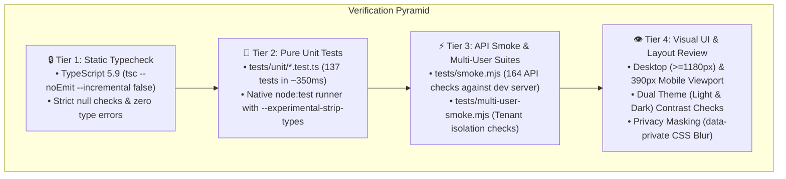

# 🧪 Pocket Testing & Verification Architecture
### Multi-Tiered Verification Pyramid, Unit Suites & Smoke Testing

> Verification standards, test suites, and regression prevention protocols for human developers and autonomous AI agents.

---

## 1. The 4-Tier Verification Pyramid

Pocket uses a strict 4-tier verification pyramid to ensure rapid feedback cycles (sub-second pure logic execution) and zero regressions:

---

## 2. Tier 1: Static Typecheck (`npm run typecheck`)

- **Command**: `npm run typecheck`
- **Compiler**: TypeScript 5.9 with `strict: true` and `--noEmit --incremental false`.
- **Duration**: ~10 seconds.
- **Invariant**: Must exit with code 0. Any type error, unresolved import, or implicit any must be fixed before committing code.

---

## 3. Tier 2: Pure Unit Test Suites (`npm run test:unit`)

### 3.1 Overview
- **Command**: `npm run test:unit`
- **Runner**: Native Node.js test runner (`node:test`) using `--experimental-strip-types`.
- **Location**: [tests/unit/](file:///d:/Projects/Github/akazad13/pocket/pocket/tests/unit/)
- **Performance**: **137 tests across 28 suites execute in ~350 milliseconds**.
- **Isolation**: Pure domain logic in [lib/](file:///d:/Projects/Github/akazad13/pocket/pocket/lib/) without edge bindings or network calls.

### 3.2 Complete Unit Test Inventory

| # | Test Suite | Module Under Test | Covered Logic & Invariants | Assertions |
|:---:|---|---|---|:---:|
| 1 | `auth.test.ts` | `lib/auth.ts` | PBKDF2 hashing, unique salts, HMAC session token roundtrip, tampering rejection | 8 |
| 2 | `accounts.test.ts` | `lib/accounts.ts` | `values()` vs `shown()`, debt polarity, net worth calculations | 7 |
| 3 | `activity.test.ts` | `lib/activity.ts` | Unified ledger sorting, filtering, and flow totals | 5 |
| 4 | `splits.test.ts` | `lib/splits.ts` | Split expense remainder math, target matching, and atomic undo payloads | 5 |
| 5 | `velocity.test.ts` | `lib/velocity.ts` | Spending pace, leap year days, burn rate, and daily allowance | 6 |
| 6 | `wellness.test.ts` | `lib/wellness.ts` | Financial Health 0-100 composite index, savings, runway & debt ratios | 4 |
| 7 | `virtual.test.ts` | `lib/virtual.ts` | Windowed virtualization slice calculation, viewport clamping, overscan | 4 |
| 8 | `tags.test.ts` | `lib/tags.ts` | Automatic #hashtag extraction (Bengali and English) and tag aggregation | 5 |
| 9 | `portfolio.test.ts` | `lib/portfolio.ts` | Stock portfolio valuation, unrealized gain/loss, asset weighting | 4 |
| 10 | `remittance.test.ts` | `lib/remittance.ts` | Foreign FX conversion with 2.5% Bangladesh Government wage earner incentive | 6 |
| 11 | `method-breakdown.test.ts` | `lib/method-breakdown.ts` | Payment channel percentage aggregation (bKash, Nagad, Card, Cash) | 3 |
| 12 | `bills.test.ts` | `lib/bills.ts` | Bill status detection (overdue, due soon, paid), date sorting | 3 |
| 13 | `budget-history.test.ts` | `lib/budget-history.ts` | 6-month budget adherence rates, streaks, and compliance trends | 2 |
| 14 | `calendar-schedule.test.ts` | `lib/calendar.ts` | Month grid construction, expense/bill intensity mapping | 3 |
| 15 | `compare.test.ts` | `lib/compare.ts` | Month-over-month differences, category shifts, new category handling | 3 |
| 16 | `csv.test.ts` | `lib/csv.ts` | Formula-injection prevention (`=`, `@`, `+`, `-`), CSV escaping | 5 |
| 17 | `csv-import.test.ts` | `lib/csv.ts` | Header auto-detection and CSV-to-backup translation | 2 |
| 18 | `filter.test.ts` | `lib/filter.ts` | Text search, category matching, date range, and amount range in cents | 7 |
| 19 | `forecast.test.ts` | `lib/forecast.ts` | Next 30-day projections from rules, bills, loan EMIs, and maturities | 4 |
| 20 | `goals.test.ts` | `lib/goals.ts` | Savings goal progress, linked account balances, monthly savings required | 3 |
| 21 | `months.test.ts` | `lib/months.ts` | Month roll-overs, day clamping for 28/30/31-day months | 3 |
| 22 | `networth.test.ts` | `lib/networth.ts` | Historical 12-month net worth time-series reconstruction | 2 |
| 23 | `quick.test.ts` | `lib/quick.ts` | Frequency and recency ranking for quick-add chips | 3 |
| 24 | `rules.test.ts` | `lib/rules.ts` | Recurring rules schedules, due months, due rows generation | 4 |
| 25 | `taxyear.test.ts` | `lib/taxyear.ts` | Bangladesh tax year (1 July to 30 June) ranges and summary sums | 2 |
| 26 | `terms.test.ts` | `lib/terms.ts` | DPS monthly compounding, FD simple interest, EMI splits | 6 |
| 27 | `yearly.test.ts` | `lib/yearly.ts` | Year-in-review averages, category share percentages, largest expenses | 5 |
| 28 | `zakat.test.ts` | `lib/zakat.ts` | Nisab threshold calculation (gold/silver), asset inclusion, 2.5% net | 5 |

---

## 4. Tier 3: API Smoke Test Suite (`npm run smoke`)

### 4.1 Overview
- **Command**: `npm run smoke`
- **Target**: Local development server (`http://127.0.0.1:5173`).
- **Script**: [tests/smoke.mjs](file:///d:/Projects/Github/akazad13/pocket/pocket/tests/smoke.mjs).
- **Assertions**: 164 automated API integration checks validating:
  - CRUD on expenses, income, transfers, accounts, bills, goals, recurring rules.
  - Category rename cascades across expenses, budgets, bills, and recurring rules.
  - Category merge batches with atomic execution.
  - 409 Conflict rejection when deleting accounts or categories with history.
  - 403 Forbidden rejection on cross-origin mutation requests.
  - 400 Bad Request rejection on invalid or negative amounts.
  - Full JSON backup export and merge-only restore validation.

### 4.2 Multi-User Isolation Smoke Test (`npm run smoke:multi-user`)
- **Command**: `npm run smoke:multi-user`
- **Script**: [tests/multi-user-smoke.mjs](file:///d:/Projects/Github/akazad13/pocket/pocket/tests/multi-user-smoke.mjs).
- **Validates**: Registers two independent tenants (`user_a` and `user_b`), creates confidential financial entries under each, and verifies that neither tenant can read, query, or mutate the other's records.

---

## 5. Tier 4: Visual & Layout Verification Checklist

For all frontend styling changes:

- [ ] **Desktop Viewport (`>=1180px`)**: Cards, navigation bars, tables, and modal dialogs render properly without horizontal overflow.
- [ ] **Mobile Viewport (`390px`)**:
  - Verify fixed bottom navigation (`.main-tabs`) does not obscure content.
  - Verify floating Add button maintains 160px clearance.
  - Verify responsive table scrollability on Reports > Monthly table.
- [ ] **Dual-Theme Contrast**:
  - Light mode: Clean contrast using design tokens in `app/pocket.css`.
  - Dark mode: Complete coverage under `html[data-theme=dark]` in `app/pocket-dark.css`. Zero unstyled white backgrounds.
- [ ] **Privacy Mode**:
  - Masking renders `BDT ••••` for formatted amounts.
  - Unformatted numeric elements blur under `html[data-private]`.
